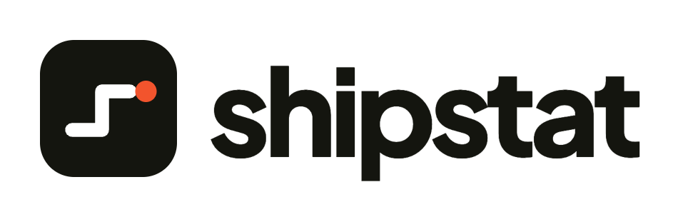
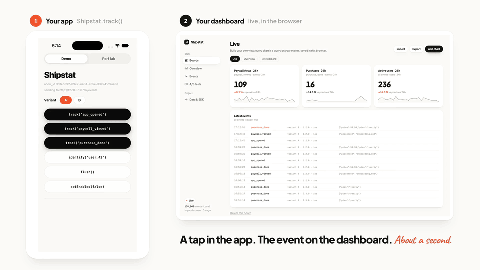
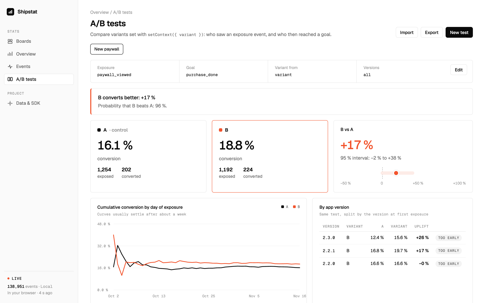
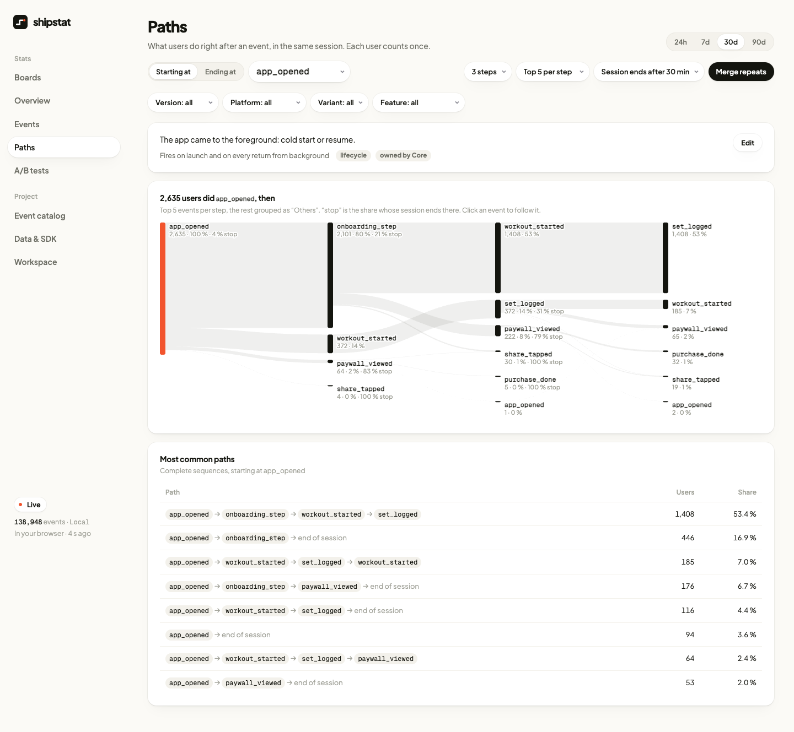

<div align="center">

<picture>
  <source media="(prefers-color-scheme: dark)" srcset="docs/brand/logo-dark.png">
  
</picture>

**Know if what you shipped works better.**

Open source analytics & A/B testing for React Native and Expo.<br>
Track the events you choose. Split any number by release and variant. Your data stays on your API.

[Setup](#setup) · [Examples](#examples) · [Dashboard](#dashboard) · [Performance](#performance) · [Compared](#compared-to-vexo-and-posthog) · [For AI assistants](#for-ai-assistants) · [Event format](#event-format)

<a href="docs/media/promo.mp4"></a>

<sub>Real recording: iOS simulator on the left, the local dashboard in live mode on the right. <a href="docs/media/promo.mp4">Full video (30 s)</a>.</sub>

</div>

## Setup

**1. Install the module** (native: Swift on iOS, Kotlin on Android)

```sh
npx expo install shipstat
```

**2. Track what matters**

```ts
import Shipstat from 'shipstat';

Shipstat.init({ endpoint: 'http://localhost:8787/events' });
Shipstat.setContext({ variant: 'B' });          // added to every following event
Shipstat.track('paywall_viewed', { placement: 'onboarding_end' });
```

**3. Open the dashboard**

```sh
npx shipstat-dashboard
```

One command: it receives events on `:8787/events`, stores them in `shipstat-events.ndjson`, and serves the dashboard at `http://localhost:8787`, already connected and live. Add `--demo` to start with 45 days of sample data.

| Running on | Endpoint |
|---|---|
| iOS simulator | `http://localhost:8787/events` |
| Android emulator | `http://10.0.2.2:8787/events` |
| A device on your Wi-Fi | `http://<your-lan-ip>:8787/events` (printed at start) |

Set context **before** the first `track()`: React runs child effects before parent effects, so a `setContext` inside a top-level `useEffect` misses the first events of your screens. Call it at module level or in a `useState` initializer.

In production, point `endpoint` at your own API and add your auth header: `init({ endpoint, headers: { Authorization: … } })`. It needs a development build or bare React Native; it does not run in Expo Go.

## Examples

**Does the new paywall convert better?**

```ts
Shipstat.setContext({ variant: user.bucket });  // 'A' or 'B', from your code or your flag provider
Shipstat.track('paywall_viewed');
Shipstat.track('purchase_done', { plan: 'yearly' });
```

In the dashboard, an A/B test is an exposure event, a goal event and the key holding the variant. You get the probability that B beats A, the uplift with its 95 % interval, and **the same comparison per app version**.

<picture>
  <source media="(prefers-color-scheme: dark)" srcset="docs/media/ab-dark.png">
  
</picture>

**Did 2.3 change how people use the app?** Nothing to add: `app_version`, `build` and the `expo-updates` id ride on every event, so any chart splits by release.

<picture>
  <source media="(prefers-color-scheme: dark)" srcset="docs/media/event-dark.png">
  
</picture>

**Who signs in mid-funnel?** Call `identify(userId)` after sign-in; the dashboard links the install's earlier anonymous events to that user, so a person is counted once in funnels and tests.

## Dashboard

A static site. It loads your events and queries them in the browser with [DuckDB-WASM](https://duckdb.org/docs/api/wasm/overview); nothing is sent anywhere except to your own source.

- **Boards you build**: line, bars, number, donut, table, funnel, live feed. Any event, any split, any filter. Saved in the browser, exportable as JSON.
- **Live mode**: new events appear as they arrive.
- **Sources**: `shipstat-dashboard`, your own read API (`GET <url>?since=<cursor>` → `{ events, next_cursor }`), a CSV / JSON / Parquet export, Supabase, or demo data.

<picture>
  <source media="(prefers-color-scheme: dark)" srcset="docs/media/board-dark.png">
  
</picture>

<picture>
  <source media="(prefers-color-scheme: dark)" srcset="docs/media/editor-dark.png">
  
</picture>

### Make it yours, share it

The dashboard is open source and runs in the browser, so you can shape it into the report your team reads:

- **Branding**: name, logo, accent color; boards with a description and a note under each chart.
- **Event catalog**: what each event means, when it fires, who owns it. Load your tracking plan or write it inline; events without a description are flagged.
- **User paths**: what people do after (or before) any event, per session, with drop-off.
- **One link for the team**: boards, catalog and branding export to one workspace file. `npx shipstat-dashboard --workspace team.json` serves it, and everyone who opens the dashboard gets the same boards.

<picture>
  
</picture>

## API

| | |
|---|---|
| `init(config)` | `endpoint` (required), `headers`, `flushAt` (50), `flushIntervalMs` (10 000), `maxQueueSize` (10 000), `enabled` (true), `debug`. Events tracked before `init` are kept. |
| `track(name, props?)` | Flat props: strings, numbers, booleans, `null`, or arrays of them. Never throws. |
| `setContext(ctx)` · `unsetContext(...keys)` | Tags added to every following event. Persisted. |
| `identify(userId \| null)` | Your user id; `null` on sign-out. |
| `setEnabled(bool)` | Opt-out. Disabling deletes events waiting on the device. Persisted. |
| `reset()` · `flush()` · `getAnonId()` | New anonymous id · send now · read the anonymous id. |

Added to every event: `app_version`, `build`, `ota`, `platform`, `os_version`, `device_model`, `locale`, `sdk_version`. No IDFA/GAID, no IP address, no screens or taps.

## Performance

| | |
|---|---|
| **≈ 1 µs** | per `track()` on the JS thread (release, median), 6–7× less than a minimal pure-JS client |
| **1.3 KB** | of JavaScript, gzipped, zero runtime dependencies |
| **23×** | less disk time per event: a burst of calls shares one SQLite transaction |
| **10–20×** | fewer bytes on the network with `compress: true` |
| **< 1 s** | for 5 000 events to reach the server |

`track()` is a JSON string and a single JSI call. Ids, context, SQLite and the network run on a native background queue. [Method, raw data and recordings](docs/perf/README.md).


## Compared to Vexo and PostHog

Same app, same run, each SDK set up the way its docs show (iOS release build, median of 10 000 calls):

| | One call on the JS thread | At 6 000 events/s |
|---|---|---|
| **Shipstat** | **1.6 µs** | 60 fps |
| Vexo 1.14 | 3.8 µs, then async work in JS | 60 fps |
| PostHog RN 4.87 | 113 µs | 43 fps |

Monthly cost at 100 custom events per active user, public prices checked on 2026-11-17 ([`node scripts/costs.mjs`](scripts/costs.mjs)):

| Active users | Shipstat | Vexo | PostHog |
|---|---|---|---|
| 10,000 | $7 | $15–75 | $0 |
| 100,000 | $7 | $285–725 | $324–1,080 |
| 500,000 | $35 | $1,165–2,765 | $1,528–3,893 |

Ranges: Vexo also bills the taps, screens and requests it captures; PostHog bills identified events twice. Shipstat is one small server. What you give up: session replay, heatmaps, crash reporting, remote feature flags. [Full comparison](docs/compare.md).

**Switching keeps your history.** `shipstat/vexo` is a drop-in for `vexo-analytics` (change the import, put your endpoint where the key was), and one command imports your past events:

```sh
npx shipstat-dashboard import vexo --app <id> --token vexo_pat_...
npx shipstat-dashboard import posthog --project <id> --key phx_...
```

Guides: [from Vexo](docs/migrate/vexo.md) · [from PostHog](docs/migrate/posthog.md).

## For AI assistants

Paste [`docs/ai/integrate.md`](docs/ai/integrate.md) into Claude Code, Cursor or Codex: it installs the module, sets context at the right time, writes a tracking plan from your navigation (10–25 events: lifecycle, activation, core actions, monetization, retention), places each `track()` where the outcome is known, and verifies it live. Also available as [`llms.txt`](llms.txt) and as a [Claude Code skill](skills/shipstat/SKILL.md).

## Event format

`POST <endpoint>` with your headers:

```json
{
  "schema": 1,
  "sent_at": "2026-11-16T09:12:05.002Z",
  "events": [{
    "id": "6f1c0d6e-…", "name": "paywall_viewed", "ts": "2026-11-16T09:12:04.120Z",
    "anon_id": "a1f9…", "user_id": null,
    "props": { "placement": "onboarding_end" },
    "context": { "variant": "B", "app_version": "2.3.0", "build": "412", "platform": "ios", "…": "…" }
  }]
}
```

Reply **2xx** to accept. **4xx** (except 408/429) drops the batch. **408, 429, 5xx** and network errors are retried with backoff, honoring `Retry-After`. Deduplicate on `id`. Types and JSON Schema: [`packages/schema`](packages/schema).

## Repository

| | |
|---|---|
| [`packages/sdk`](packages/sdk) | The `shipstat` module: TypeScript, Swift, Kotlin |
| [`packages/dashboard`](packages/dashboard) | Dashboard (React, DuckDB-WASM) and the `shipstat-dashboard` command |
| [`packages/schema`](packages/schema) | Event types and JSON Schema |
| [`apps/example`](apps/example) | Example app with a Perf lab |
| [`apps/site`](apps/site) | Landing page; `/demo` is the dashboard on sample data |
| [`docs`](docs) | [Design](docs/design.md), [performance study](docs/perf/README.md) |
| [`scripts/media`](scripts/media) | Logo, screenshots and promo video, reproducible |
| [`docs/ai`](docs/ai) · [`skills`](skills) · [`llms.txt`](llms.txt) | Integration prompt and skill for AI assistants |
| [`docs/brand`](docs/brand) | Logo, icons |

```sh
pnpm install
pnpm --filter shipstat test && pnpm --filter shipstat-dashboard test
pnpm --filter shipstat-dashboard build && node packages/dashboard/bin/shipstat-dashboard.mjs --demo
```

## Status

0.1, not yet on npm. Tested on iOS simulators and Android emulators, in debug and release. Next: npm release, a Supabase receiver, a hosted demo, measurements on physical devices.

MIT
