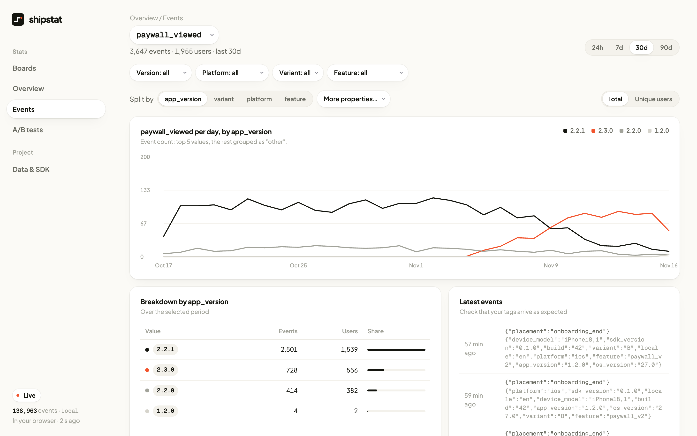
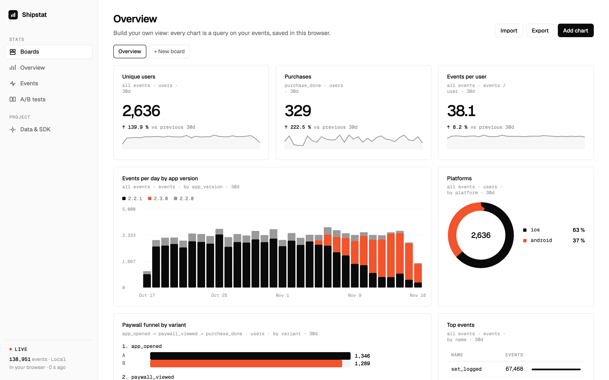
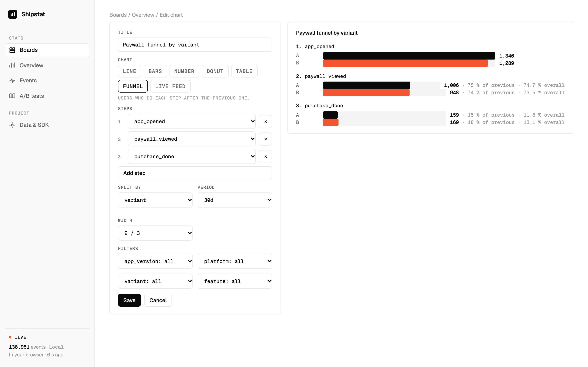

<div align="center">

# Shipstat

**Know if what you shipped works better.**

Open source analytics & A/B testing for React Native and Expo.<br>
Track the events you choose. Split any number by release and variant. Your data stays on your API.

[Setup](#setup) · [Examples](#examples) · [Dashboard](#dashboard) · [Performance](docs/perf/README.md) · [Event format](#event-format)

<a href="docs/media/promo.mp4"></a>

<sub>Real recording: iOS simulator on the left, the local dashboard in live mode on the right. <a href="docs/media/promo.mp4">Full video (30 s)</a>.</sub>

</div>

## Setup

**1. Install the module** (native: Swift on iOS, Kotlin on Android)

```sh
npx expo install shipstat
```

**2. Track what matters**

```ts
import Shipstat from 'shipstat';

Shipstat.init({ endpoint: 'http://localhost:8787/events' });
Shipstat.setContext({ variant: 'B' });          // added to every following event
Shipstat.track('paywall_viewed', { placement: 'onboarding_end' });
```

**3. Open the dashboard**

```sh
npx shipstat-dashboard
```

One command: it receives events on `:8787/events`, stores them in `shipstat-events.ndjson`, and serves the dashboard at `http://localhost:8787`, already connected and live. Add `--demo` to start with 45 days of sample data.

| Running on | Endpoint |
|---|---|
| iOS simulator | `http://localhost:8787/events` |
| Android emulator | `http://10.0.2.2:8787/events` |
| A device on your Wi-Fi | `http://<your-lan-ip>:8787/events` (printed at start) |

Set context **before** the first `track()`: React runs child effects before parent effects, so a `setContext` inside a top-level `useEffect` misses the first events of your screens. Call it at module level or in a `useState` initializer.

In production, point `endpoint` at your own API and add your auth header: `init({ endpoint, headers: { Authorization: … } })`. It needs a development build or bare React Native; it does not run in Expo Go.

## Examples

**Does the new paywall convert better?**

```ts
Shipstat.setContext({ variant: user.bucket });  // 'A' or 'B', from your code or your flag provider
Shipstat.track('paywall_viewed');
Shipstat.track('purchase_done', { plan: 'yearly' });
```

In the dashboard, an A/B test is an exposure event, a goal event and the key holding the variant. You get the probability that B beats A, the uplift with its 95 % interval, and **the same comparison per app version**.

<picture>
  <source media="(prefers-color-scheme: dark)" srcset="docs/media/ab-dark.png">
  
</picture>

**Did 2.3 change how people use the app?** Nothing to add: `app_version`, `build` and the `expo-updates` id ride on every event, so any chart splits by release.

<picture>
  <source media="(prefers-color-scheme: dark)" srcset="docs/media/event-dark.png">
  
</picture>

**Who signs in mid-funnel?** Call `identify(userId)` after sign-in; the dashboard links the install's earlier anonymous events to that user, so a person is counted once in funnels and tests.

## Dashboard

A static site. It loads your events and queries them in the browser with [DuckDB-WASM](https://duckdb.org/docs/api/wasm/overview); nothing is sent anywhere except to your own source.

- **Boards you build**: line, bars, number, donut, table, funnel, live feed. Any event, any split, any filter. Saved in the browser, exportable as JSON.
- **Live mode**: new events appear as they arrive.
- **Sources**: `shipstat-dashboard`, your own read API (`GET <url>?since=<cursor>` → `{ events, next_cursor }`), a CSV / JSON / Parquet export, Supabase, or demo data.

<picture>
  <source media="(prefers-color-scheme: dark)" srcset="docs/media/board-dark.png">
  
</picture>

<picture>
  <source media="(prefers-color-scheme: dark)" srcset="docs/media/editor-dark.png">
  
</picture>

## API

| | |
|---|---|
| `init(config)` | `endpoint` (required), `headers`, `flushAt` (50), `flushIntervalMs` (10 000), `maxQueueSize` (10 000), `enabled` (true), `debug`. Events tracked before `init` are kept. |
| `track(name, props?)` | Flat props: strings, numbers, booleans, `null`, or arrays of them. Never throws. |
| `setContext(ctx)` · `unsetContext(...keys)` | Tags added to every following event. Persisted. |
| `identify(userId \| null)` | Your user id; `null` on sign-out. |
| `setEnabled(bool)` | Opt-out. Disabling deletes events waiting on the device. Persisted. |
| `reset()` · `flush()` · `getAnonId()` | New anonymous id · send now · read the anonymous id. |

Added to every event: `app_version`, `build`, `ota`, `platform`, `os_version`, `device_model`, `locale`, `sdk_version`. No IDFA/GAID, no IP address, no screens or taps.

## Performance

`track()` costs **≈ 1 µs on the JS thread** in release builds: a JSON string and one JSI call. Ids, context, SQLite and network run on a native background queue. That is 6–7× less than a minimal pure-JS client; 5 000 events reach the server in under a second. [Method, raw data and recordings](docs/perf/README.md).


## Event format

`POST <endpoint>` with your headers:

```json
{
  "schema": 1,
  "sent_at": "2026-11-16T09:12:05.002Z",
  "events": [{
    "id": "6f1c0d6e-…", "name": "paywall_viewed", "ts": "2026-11-16T09:12:04.120Z",
    "anon_id": "a1f9…", "user_id": null,
    "props": { "placement": "onboarding_end" },
    "context": { "variant": "B", "app_version": "2.3.0", "build": "412", "platform": "ios", "…": "…" }
  }]
}
```

Reply **2xx** to accept. **4xx** (except 408/429) drops the batch. **408, 429, 5xx** and network errors are retried with backoff, honoring `Retry-After`. Deduplicate on `id`. Types and JSON Schema: [`packages/schema`](packages/schema).

## Repository

| | |
|---|---|
| [`packages/sdk`](packages/sdk) | The `shipstat` module: TypeScript, Swift, Kotlin |
| [`packages/dashboard`](packages/dashboard) | Dashboard (React, DuckDB-WASM) and the `shipstat-dashboard` command |
| [`packages/schema`](packages/schema) | Event types and JSON Schema |
| [`apps/example`](apps/example) | Example app with a Perf lab |
| [`apps/site`](apps/site) | Landing page; `/demo` is the dashboard on sample data |
| [`docs`](docs) | Design document, performance study |
| [`scripts/media`](scripts/media) | Screenshots and promo video, reproducible |

```sh
pnpm install
pnpm --filter shipstat test && pnpm --filter shipstat-dashboard test
pnpm --filter shipstat-dashboard build && node packages/dashboard/bin/shipstat-dashboard.mjs --demo
```

## Status

0.1, not yet on npm. Tested on iOS simulators and Android emulators, in debug and release. Next: npm release, a Supabase receiver, a hosted demo, measurements on physical devices.

MIT
