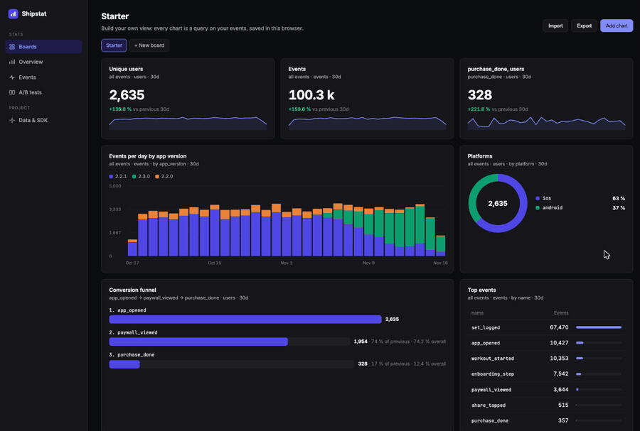
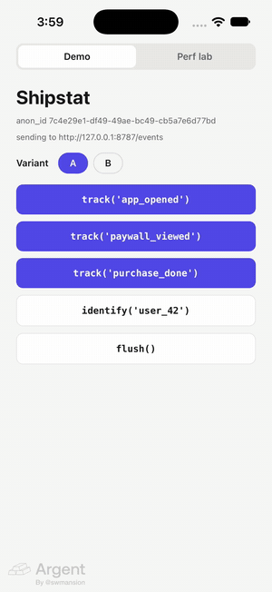
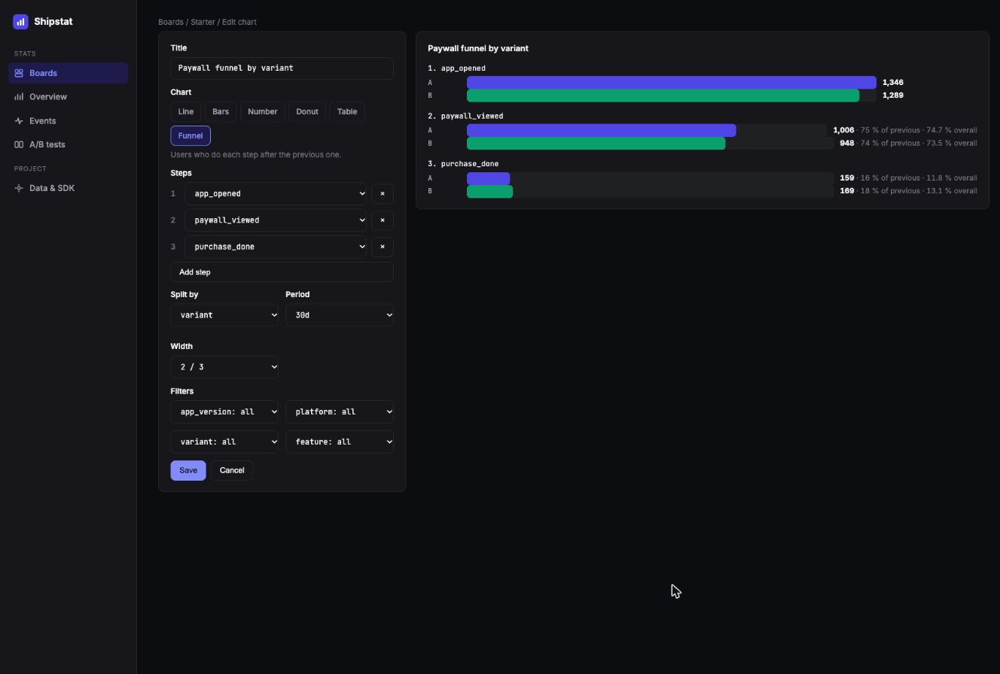
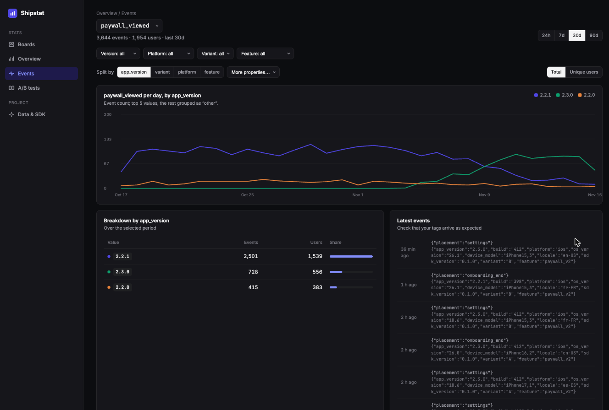
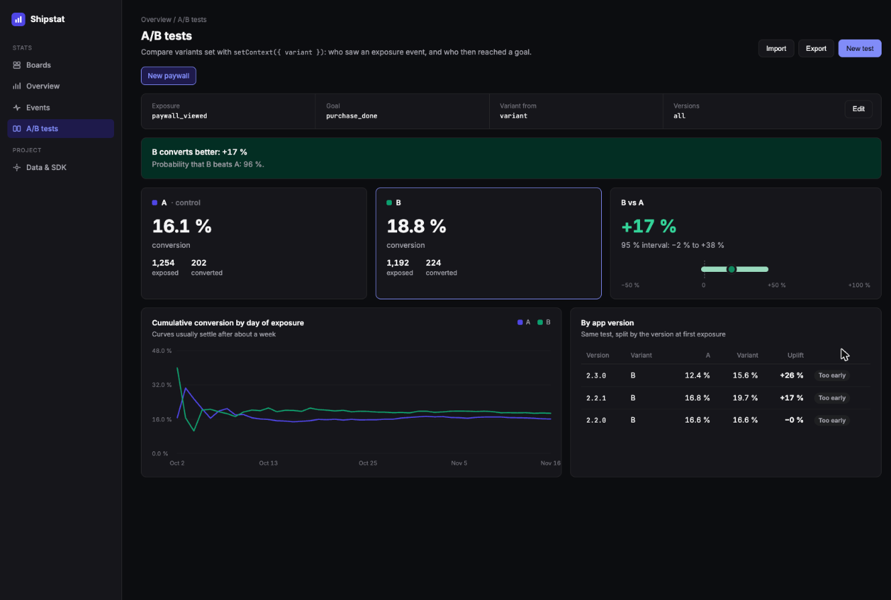
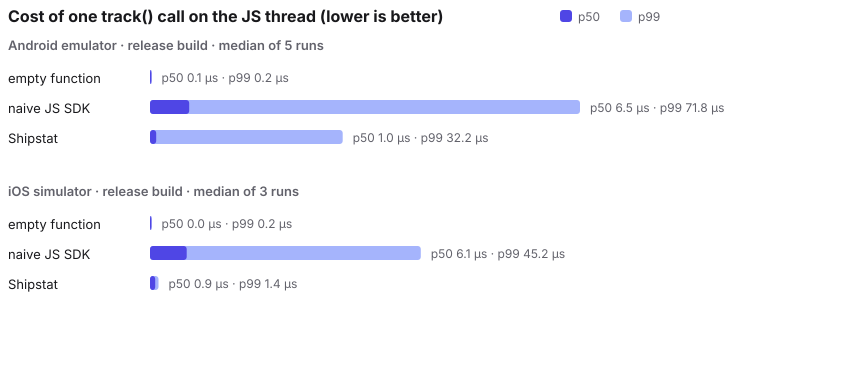

<div align="center">

# Shipstat

**Open source analytics & A/B testing for React Native and Expo.**

Know if what you just shipped works better: compare events by app version and by variant.<br>
No autocapture, no screen tracking, no session replay. Only the events you send, to the API you choose.

[Quick start](#quick-start) · [Dashboard](#dashboard) · [A/B tests](#ab-tests) · [Performance](docs/perf/README.md) · [Event format](#event-format)




</div>

## Why

Most mobile analytics tools capture everything: every screen, every tap, every session. That is a lot of data you did not ask for, sent to someone else's servers, and the question you actually have, *did version 2.3 or variant B do better?*, is still hard to answer.

Shipstat does one thing:

- **You send events** with `track()`, tagged with whatever context you set (`variant`, `feature`, …).
- **Every event carries the app version, build and OTA update** automatically, so any number can be split by release.
- **Events go to your API**, in a documented JSON format. Nobody else sees them.
- **The dashboard runs in your browser.** It loads your events and queries them with DuckDB. There is no server to run, and you can host it yourself.

## Quick start

```sh
npx expo install shipstat
```

```ts
import Shipstat from 'shipstat';

Shipstat.init({
  endpoint: 'https://api.example.com/events',
  headers: { Authorization: `Bearer ${token}` },
});

// Added to every following event, persisted across launches.
Shipstat.setContext({ variant: 'B', feature: 'paywall_v2' });

Shipstat.track('paywall_viewed', { placement: 'onboarding_end' });
```

Works with Expo (development builds) and bare React Native apps that use `expo-modules-core`. It is a native module, so it does not run in Expo Go.

<table>
<tr>
<td></td>
<td>

**What happens on `track()`**

1. JavaScript hands the name, the props (as one JSON string) and a timestamp to the native module, and returns. **≈ 1 µs.**
2. On a background queue, the native side adds an id, the anonymous id, the context, and writes the event to SQLite.
3. Events are sent in batches: every 50 events, every 10 s, and when the app goes to the background.
4. Failed sends are retried with backoff. Offline, events wait on disk (up to 10 000, oldest dropped first).

</td>
</tr>
</table>

### API

| Function | |
|---|---|
| `init(config)` | `endpoint` (required), `headers`, `flushAt` (50), `flushIntervalMs` (10 000), `maxQueueSize` (10 000), `enabled` (true), `debug` (false). Events tracked before `init` are kept. |
| `track(name, props?)` | Props are flat: strings, numbers, booleans, `null`, or arrays of them. |
| `setContext(ctx)` / `unsetContext(...keys)` | Global tags merged into every following event. Persisted. |
| `identify(userId \| null)` | Attach your own user id; `null` on sign-out. The dashboard links the install's earlier anonymous events to that user, so funnels and A/B tests count one person once. |
| `setEnabled(bool)` | User opt-out. Disabling deletes events still waiting on the device; nothing is stored or sent until re-enabled. Persisted. |
| `reset()` | New anonymous id; context and user id cleared. |
| `flush()` | Send now. Resolves when the attempt is over. |
| `getAnonId()` | The anonymous id of this install. |

**Added automatically:** `app_version`, `build`, `ota` (with `expo-updates`), `platform`, `os_version`, `device_model`, `locale`, `sdk_version`. No IDFA/GAID, no IP address, no personal data.

## Dashboard

A static site: open it, load your events, and everything is computed in the browser with [DuckDB-WASM](https://duckdb.org/docs/api/wasm/overview). Loaded events are kept in the browser between visits; nothing is sent anywhere except to your own source.

**Load events from**

- **your API**: a read route, `GET <url>?since=<cursor>&limit=5000` → `{ events, next_cursor }`
- **a file**: CSV, JSON, NDJSON or Parquet export of your events table
- **Supabase**: project URL and a read-only key
- **demo data**, to try it in ten seconds

**Build your own boards.** Every chart is a query you configure: line, bars, number, donut, table or funnel; any event; events, unique users or events per user; split by any property or context key; filtered by version, platform, variant or feature. Boards are saved in the browser and can be exported as JSON to share or keep in your repo.

<table>
<tr>
<td></td>
<td></td>
</tr>
<tr>
<td></td>
<td></td>
</tr>
</table>

```sh
pnpm install
pnpm --filter shipstat-dashboard dev          # http://localhost:5173

pnpm --filter shipstat-dashboard build        # static dist/ for any host
docker build -t shipstat-dashboard -f packages/dashboard/Dockerfile .
```

## A/B tests

Set the variant in your app, then define a test in the dashboard: an **exposure** event, a **goal** event, and the key holding the variant.

```ts
Shipstat.setContext({ variant: user.bucket }); // 'A' or 'B', chosen by your code or your flag provider
Shipstat.track('paywall_viewed');
// later
Shipstat.track('purchase_done', { plan: 'yearly' });
```

For each variant, Shipstat counts users exposed and users who reach the goal **after** their first exposure, then gives:

- the probability that the variant beats the control (Beta-Binomial posterior, uniform prior),
- the relative uplift with a 95 % credible interval,
- the same comparison **per app version**, because a variant that wins on 2.3 and loses on 2.2 is a different story,
- an estimate of how many more exposures are needed when there is no winner yet.

## Performance

`track()` costs about **1 µs on the JS thread** in release builds, 6–7× less than a minimal pure-JS client, and 5 000 events reach the server in under a second. Full methodology, raw data and recordings: [docs/perf](docs/perf/README.md).



## Event format

`POST <endpoint>`, `Content-Type: application/json`, with your headers:

```json
{
  "schema": 1,
  "sent_at": "2026-11-16T09:12:05.002Z",
  "events": [{
    "id": "6f1c0d6e-…",
    "name": "paywall_viewed",
    "ts": "2026-11-16T09:12:04.120Z",
    "anon_id": "a1f9…",
    "user_id": null,
    "props": { "placement": "onboarding_end" },
    "context": {
      "variant": "B", "feature": "paywall_v2",
      "app_version": "2.3.0", "build": "412", "ota": "b7e2…",
      "platform": "ios", "os_version": "26.1", "device_model": "iPhone16,2",
      "locale": "fr-FR", "sdk_version": "0.1.0"
    }
  }]
}
```

Reply **2xx** to accept a batch. **4xx** (except 408 and 429) drops it. **408, 429, 5xx** and network errors are retried with exponential backoff, honoring `Retry-After`. Use `id` to deduplicate. TypeScript types and a JSON Schema are in [`packages/schema`](packages/schema).

No backend yet? [`examples/dev-server`](examples/dev-server/server.mjs) is a zero-dependency Node server that stores events and serves them to the dashboard:

```sh
node examples/dev-server/server.mjs --token dev-token
```

## How it compares

| | Shipstat | Typical hosted mobile analytics |
|---|---|---|
| What is collected | Only your `track()` calls | Screens, taps, sessions, often replays |
| Where data goes | Your API | The vendor's servers |
| Analysis | In your browser, or your own tools | Vendor dashboard |
| Split by app version / OTA | Built in, on every event | Varies |
| Cost | Your hosting | Per-event or per-user pricing |
| License | MIT | Usually closed source |

## Repository

| Path | |
|---|---|
| [`packages/sdk`](packages/sdk) | Expo module `shipstat`: TypeScript, Swift, Kotlin |
| [`packages/schema`](packages/schema) | Event types and JSON Schema |
| [`packages/dashboard`](packages/dashboard) | Static dashboard (React, DuckDB-WASM) |
| [`apps/example`](apps/example) | Example app with the Perf lab |
| [`examples/dev-server`](examples/dev-server) | Local ingest and read server |
| [`docs`](docs) | Design document, performance study |

## Development

```sh
pnpm install
pnpm --filter shipstat test            # SDK unit tests
pnpm --filter shipstat-dashboard test  # dashboard unit tests
cd apps/example && npx expo run:ios    # or run:android
```

## Status and roadmap

Early (0.1). Working and tested on iOS and Android simulators; not yet published to npm.

- [ ] Publish `shipstat` to npm
- [ ] Ready-to-deploy receivers: Supabase, Node + Postgres
- [ ] Hosted public dashboard
- [ ] Guaranteed background upload on Android (WorkManager)
- [ ] Measurements on physical devices

## License

[MIT](LICENSE)
