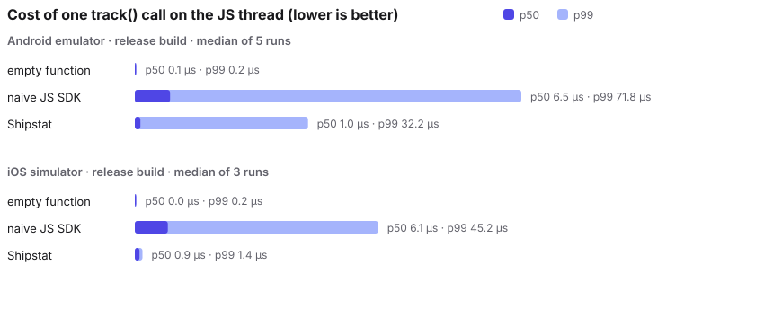
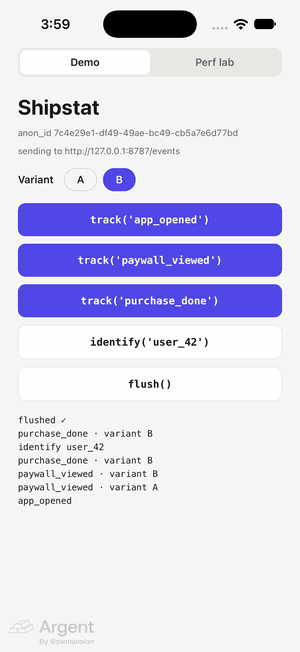
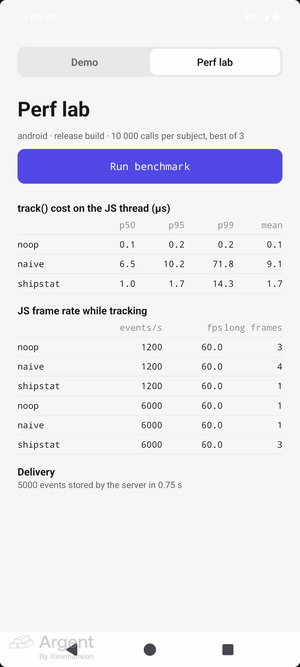

# Performance study

**Question:** how much does `Shipstat.track()` cost the app, compared with doing nothing and with a typical pure-JavaScript analytics client?

**Short answer:** about **1 µs per call** on the JS thread in release builds (iOS and Android), **6–7× less than a minimal JS client**, with a much tighter tail on iOS. At realistic and heavy event rates (1 200 and 6 000 events per second) none of the three subjects dropped frames. 5 000 events reach the server in **0.3 s (iOS) to 0.6 s (Android)**.



<table>
<tr>
<td></td>
<td></td>
</tr>
<tr><td align="center">iOS simulator, release (<a href="../media/ios-perf-lab.mp4">mp4</a>)</td><td align="center">Android emulator, release (<a href="../media/android-perf-lab.mp4">mp4</a>)</td></tr>
</table>

## Subjects

| Subject | What runs on the JS thread for each call |
|---|---|
| **empty function** | A call to a function that does nothing. The floor: the cost of calling anything at all. |
| **naive JS SDK** | What most JavaScript analytics clients do: generate an id, format an ISO date, merge the context, push to an in-memory queue; every 50 events, `JSON.stringify` the batch and `fetch` it. No persistence, so this is a **lower bound** for real JS SDKs, which usually also write the queue to AsyncStorage. Source: [`apps/example/src/naiveSdk.ts`](../../apps/example/src/naiveSdk.ts). |
| **Shipstat** | `JSON.stringify(props)` and one synchronous JSI call carrying the name, the props string and a timestamp. The native side copies them to a background queue and returns; ids, context, SQLite and network all happen off the JS thread. |

## Results

Release builds, Hermes bytecode, no debugger. Each run times **10 000 calls one by one** after 1 000 warm-up calls, three times per subject, keeping the best run by p50 (to limit host noise). The tables are the **median of all runs**: 3 on iOS, 5 on Android. Raw data: [`raw-runs.ndjson`](raw-runs.ndjson), aggregated: [`results.json`](results.json).

### iOS simulator (iOS 27.0, iPhone 17 Pro profile)

Cost of one call, in microseconds:

| | p50 | p95 | p99 | mean | max |
|---|---:|---:|---:|---:|---:|
| empty function | 0.0 | 0.2 | 0.2 | 0.1 | 147.1 |
| naive JS SDK | 6.1 | 8.0 | 45.2 | 7.4 | 477.1 |
| **Shipstat** | **0.9** | **1.1** | **1.4** | **0.9** | 115.5 |

### Android emulator (API 35, arm64)

| | p50 | p95 | p99 | mean | max |
|---|---:|---:|---:|---:|---:|
| empty function | 0.1 | 0.1 | 0.2 | 0.1 | 38.0 |
| naive JS SDK | 6.5 | 10.2 | 71.8 | 9.1 | 626.7 |
| **Shipstat** | **1.0** | **1.9** | **32.2** | **2.1** | 1 264.4 |

### Frame rate while tracking

`track()` called N times on every animation frame for 3 s; a long frame is one over 20 ms.

| Events / s | Subject | iOS fps | iOS long frames | Android fps | Android long frames |
|---:|---|---:|---:|---:|---:|
| 1 200 | empty function | 60.0 | 0 | 60.0 | 2 |
| 1 200 | naive JS SDK | 60.0 | 0 | 60.0 | 4 |
| 1 200 | Shipstat | 60.0 | 0 | 60.0 | 1 |
| 6 000 | empty function | 60.0 | 0 | 60.0 | 2 |
| 6 000 | naive JS SDK | 60.0 | 0 | 60.0 | 1 |
| 6 000 | Shipstat | 60.0 | 0 | 60.0 | 0 |

### Delivery

5 000 events tracked in a burst, then `flush()`: time until the local server has stored all of them.

| | iOS | Android |
|---|---:|---:|
| 5 000 events | 0.27 s | 0.61 s |

## Reading the numbers

- **The typical call is 6–7× cheaper than a minimal JS client** on both platforms, and close to the cost of calling an empty function.
- **The tail is where native pays off on iOS**: p99 1.4 µs against 45 µs. On Android the p99 (32 µs) is higher than on iOS: crossing JNI occasionally waits, and the emulator is noisy (the first Android run measured 3.1 µs at p50, later runs 1.0 µs). The worst single call on Android was 1.3 ms, once in 50 000.
- **Frames:** on this machine, even 6 000 events per second do not drop frames for any subject. The difference shows on slower phones and in apps whose JS thread is already busy; this benchmark does not measure that.

## Limits

- Simulator and emulator on an Apple M5 Pro (48 GB, macOS 27.0.1), not physical phones. Absolute numbers will be higher on mid-range Android devices; the ratios are what to look at.
- The naive JS client does not persist its queue. Real JS SDKs that write to AsyncStorage on each event cost more than shown here.
- Memory and battery were not measured.

## Reproduce

```sh
node examples/dev-server/server.mjs --token dev-token          # collects reports in bench-results.ndjson
cd apps/example && npx expo run:ios --configuration Release     # or: npx expo run:android --variant release
# In the app: Perf lab → Run benchmark (as many runs as you like)
node scripts/perf-report.mjs examples/dev-server/bench-results.ndjson
```
